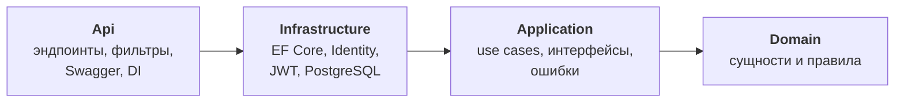
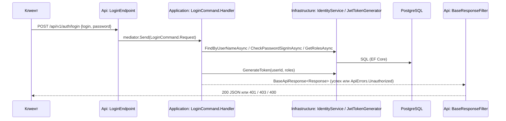
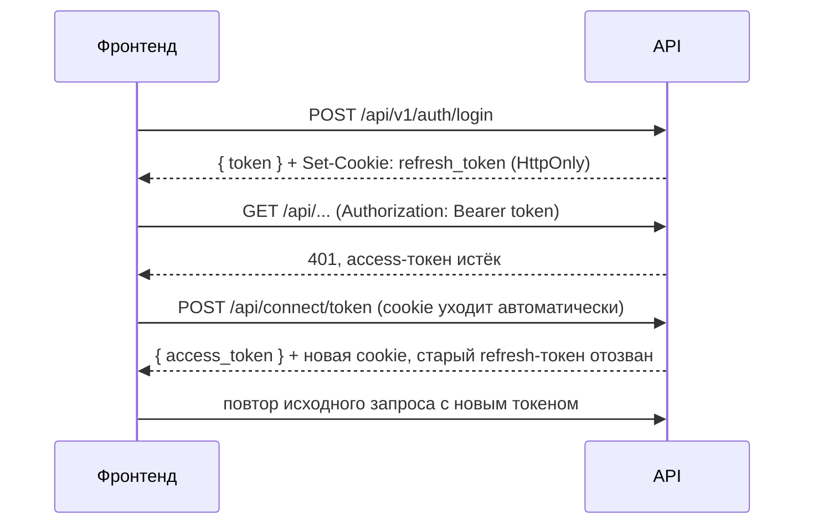

# Template Project

Шаблон веб-приложения: бэкенд на **ASP.NET Core 9** по принципам **Clean Architecture** и фронтенд на **Vue 3**.
Из коробки есть регистрация, вход по JWT, роли (`User`, `Admin`, `Manager`), сидинг администратора и Swagger.

- [Стек](#стек)
- [Структура репозитория](#структура-репозитория)
- [Быстрый старт](#быстрый-старт)
- [Порты и связь с фронтендом](#порты-и-связь-с-фронтендом)
- [Архитектура бэкенда](#архитектура-бэкенда)
- [Бизнес-сущности](#бизнес-сущности)
- [Как добавить новую сущность (пошаговый пример)](#как-добавить-новую-сущность-пошаговый-пример)
- [Авторизация](#авторизация)
- [Миграции](#миграции)
- [Соглашения по коду](#соглашения-по-коду)
- [Известные ограничения](#известные-ограничения)

---

## Стек

| Часть | Технологии |
|---|---|
| Бэкенд | .NET 9, ASP.NET Core Minimal API, MediatR 12, AutoMapper 13, OneOf, EF Core 9 + Npgsql, ASP.NET Identity, JWT Bearer, OpenAPI + Swagger UI |
| База данных | PostgreSQL |
| Фронтенд | Vue 3, TypeScript, Vite, Pinia, PrimeVue, Tailwind (подробно: [frontend/FRONTEND.md](frontend/FRONTEND.md)) |

## Структура репозитория

```
template-project-clean-arch/
├── README.md                ← этот файл
├── AGENTS.md / CLAUDE.md    ← инструкции для AI-агентов
├── frontend/                ← Vue-приложение (см. frontend/FRONTEND.md)
└── backend/
    ├── TemplateProject.sln
    ├── Directory.Build.props        ← общие настройки всех проектов (net9.0, Nullable, ImplicitUsings)
    ├── compose.yaml                 ← Docker: API + PostgreSQL
    └── src/
        ├── TemplateProject.Domain/          ← ядро: бизнес-сущности и правила
        ├── TemplateProject.Application/     ← сценарии использования (use cases)
        ├── TemplateProject.Infrastructure/  ← БД, Identity, JWT: реализация интерфейсов
        └── TemplateProject.Api/             ← HTTP: эндпоинты, фильтры, Swagger, сборка DI
```

---

## Быстрый старт

### Что нужно установить

- [.NET 9 SDK](https://dotnet.microsoft.com/download/dotnet/9.0)
- PostgreSQL 16+ (локально или в Docker)
- Node.js 20+ (для фронтенда)
- Инструмент EF Core **версии 9** (нужен только для создания миграций):

```bash
dotnet tool install -g dotnet-ef --version 9.0.13
```

> Если уже стоит `dotnet-ef` 10.x без рантайма .NET 10, он падает с ошибкой `hostfxr.dll not found`.
> В этом случае обновите его до 9-й версии: `dotnet tool update -g dotnet-ef --version 9.0.13`.

### 1. Настройки для разработки

Создайте файл `backend/src/TemplateProject.Api/appsettings.Development.json`. Он есть в `.gitignore`, **не коммитьте его**:

```json
{
  "ConnectionStrings": {
    "Database": "Host=localhost;Port=5432;Database=template_db;Username=<DB_USER>;Password=<DB_PASSWORD>;Include Error Detail=true"
  },
  "AdminCredentials": {
    "Email": "admin@gmail.com",
    "Password": "Admin123!"
  },
  "Auth": {
    "Issuer": "https://localhost:7262",
    "Audience": "http://localhost:5205",
    "Key": "<YOUR_KEY>",
    "Lifetime": "05:00:00",
    "RefreshTokenLifetime": "30.00:00:00"
  }
}
```

| Ключ | Назначение |
|---|---|
| `ConnectionStrings:Database` | Подключение к PostgreSQL. Базу создавать заранее не нужно: её создаст миграция при старте |
| `AdminCredentials` | Администратор, который создаётся (или обновляется) при каждом старте приложения |
| `Auth:Key` | Ключ подписи JWT (HMAC-SHA256), минимум 32 символа |
| `Auth:Lifetime` | Время жизни access-токена |
| `Auth:RefreshTokenLifetime` | Время жизни refresh-токена (по умолчанию 30 дней) |

### 2. HTTPS-сертификат

Чтобы браузер не ругался на `https://localhost:7262`, один раз доверьте dev-сертификату:

```bash
dotnet dev-certs https --trust
```

### 3. Запуск бэкенда

```bash
dotnet run --project backend/src/TemplateProject.Api --launch-profile https
```

При старте приложение само:
1. применяет миграции (создаёт базу, если её нет);
2. создаёт роли `Admin`, `User`, `Manager` и администратора из `AdminCredentials`;
3. в Development-окружении открывает Swagger: **https://localhost:7262/swagger**.

В Rider или Visual Studio выберите профиль **`https`**: он стоит первым и сам открывает браузер на Swagger.

### 4. Запуск фронтенда

```bash
cd frontend/app
npm install
npm run dev
```

Фронтенд откроется на http://localhost:5173. Перед этим прочитайте раздел [Порты и связь с фронтендом](#порты-и-связь-с-фронтендом).

### Запуск через Docker

```bash
cd backend
docker compose up --build
```

Поднимаются API (`http://localhost:7262`, внутри контейнера порт 8080) и PostgreSQL (`localhost:5860`). Настройки передаются через переменные окружения в `compose.yaml`.

### API

| Метод | Путь | Описание | Ответ |
|---|---|---|---|
| POST | `/api/v1/auth/sign-up` | Регистрация (`email`, `password`, `phoneNumber?`, `name`, `age`) | `200 {"data":{"message":"Sign up successful"},"status":"Ok"}`, `400` если ошибка валидации или email занят |
| POST | `/api/v1/auth/login` | Вход (`login` = email, `password`) | `200 {"userName":"<id>","token":"<jwt>","status":"Ok"}` + cookie `refresh_token`, `400` при пустых полях, `401` при неверных данных |
| POST | `/api/connect/token` | Обновление access-токена (form: `grant_type=refresh_token`, `client_id`), refresh-токен берётся из cookie | `200 {"access_token":"<jwt>","token_type":"Bearer","expires_in":<сек>}` + новая cookie, `400 {"error":"invalid_grant"}` / `{"error":"unsupported_grant_type"}` |
| POST | `/api/connect/logout` | Отзыв refresh-токена из cookie и удаление cookie | `200 {"status":"Ok"}` |

Access-токен содержит claims `sub` (Id пользователя), `email`, `role`, `iat`, `exp`, `iss`, `aud`. Его можно передать в заголовке `Authorization: Bearer <token>` или в query-параметре `?access_token=<token>`.
Как устроены refresh-токены, описано в разделе [Авторизация](#авторизация).

---

## Порты и связь с фронтендом

| Что | Адрес |
|---|---|
| API, профиль `https` | **https://localhost:7262** (и одновременно http://localhost:5228) |
| API, профиль `http` | http://localhost:5228 |
| API в Docker | http://localhost:7262 (снаружи контейнера; внутри порт 8080) |
| PostgreSQL локально | localhost:5432 |
| PostgreSQL в Docker | localhost:5860 |
| Фронтенд (Vite dev server) | http://localhost:5173 |
| **Прокси фронтенда `/api` →** | **http://localhost:5000** ⚠️ |

### ⚠️ Порты фронтенда и бэкенда не совпадают

В [frontend/app/vite.config.ts](frontend/app/vite.config.ts) запросы `/api/*` проксируются на `http://localhost:5000`.
Бэкенд на этом порту не слушает ни в одном профиле, поэтому из коробки фронтенд до API не достучится.
Расхождение было и до перехода на чистую архитектуру. Чтобы связать фронт и бэк, выберите один вариант:

**Вариант А (рекомендуется): поправить прокси во фронтенде**

```ts
// frontend/app/vite.config.ts
proxy: {
  '/api': {
    target: 'https://localhost:7262', // или 'http://localhost:5228'
    changeOrigin: true,
    secure: false, // dev-сертификат самоподписанный
  },
},
```

**Вариант Б: запустить бэкенд на порту 5000**

```bash
dotnet run --project backend/src/TemplateProject.Api --launch-profile http -- --urls http://localhost:5000
```

---

## Архитектура бэкенда

### Слои и правило зависимостей

Главное правило: **зависимости направлены только внутрь**. Внутренний слой ничего не знает о внешних.



| Проект | Ссылается на | Внешние пакеты | Чего здесь быть **не должно** |
|---|---|---|---|
| **Domain** | ничего | ничего | EF, ASP.NET, MediatR, атрибуты сериализации |
| **Application** | Domain | MediatR, AutoMapper, OneOf, Logging.Abstractions | EF Core, ASP.NET Core, `HttpContext`, `IResult`, HTTP-статусы |
| **Infrastructure** | Application (транзитивно Domain) | EF Core, Npgsql, ASP.NET Identity, System.IdentityModel.Tokens.Jwt | Эндпоинты, бизнес-правила |
| **Api** | Infrastructure (транзитивно всё) | ASP.NET Core, JwtBearer, OpenAPI, Swagger UI | Бизнес-логика, прямые запросы к `DatabaseContext` из эндпоинтов |

Правило проверяет компилятор: если в Application написать `using TemplateProject.Infrastructure...`, проект не соберётся, потому что ссылки нет.

> **Почему Api ссылается на Infrastructure?** Api здесь не только presentation-слой, но и **composition root**, то есть место, где собирается DI-контейнер.
> Чтобы зарегистрировать `IdentityService` как реализацию `IIdentityService`, нужно видеть оба типа. Это стандартный компромисс.
> Договорённость такая: эндпоинты работают только через MediatR и не обращаются к Infrastructure напрямую.

### Что лежит в каждом слое

```
TemplateProject.Domain/
└── Constants/Roles.cs                  ← имена ролей: User, Admin, Manager

TemplateProject.Application/
├── Common/
│   ├── Abstractions/                   ← интерфейсы, которые реализуют внешние слои
│   │   ├── IIdentityService.cs         ← пользователи, пароли, роли
│   │   ├── IJwtTokenGenerator.cs       ← выпуск JWT
│   │   ├── IRefreshTokenService.cs     ← выпуск, погашение и отзыв refresh-токенов
│   │   ├── IUnitOfWork.cs              ← SaveChangesAsync
│   │   └── ICurrentUserProvider.cs     ← Id текущего пользователя
│   ├── Behaviors/LoggingBehavior.cs    ← MediatR pipeline: логирование каждого запроса
│   ├── Errors/                         ← ApiErrors (BadRequest, NotFound, ...), BaseError, Errors
│   ├── Mappings/BaseMapping.cs         ← профиль AutoMapper
│   └── Models/                         ← BaseApiResponse<T>, ErrorOr<T>, Unit, DTO
├── Features/Auth/
│   ├── LoginCommand.cs                 ← Request + Response + Handler
│   ├── SignUpCommand.cs
│   ├── RefreshTokenCommand.cs          ← обмен refresh-токена на новую пару токенов
│   └── LogoutCommand.cs
└── DependencyInjection.cs              ← AddApplication()

TemplateProject.Infrastructure/
├── Authentication/                     ← AuthSettings, JwtTokenGenerator
├── Identity/                           ← ApplicationUser/Role/UserRole, IdentityService,
│                                         RefreshToken (сущность), RefreshTokenService
├── Persistence/
│   ├── DatabaseContext.cs              ← EF DbContext, он же IUnitOfWork
│   ├── DatabaseInitializer.cs          ← миграция и сидинг при старте
│   └── Migrations/
└── DependencyInjection.cs              ← AddInfrastructure()

TemplateProject.Api/
├── Endpoints/                          ← IFeatureEndpoint + Auth/LoginEndpoint, SignUpEndpoint,
│                                         TokenEndpoints (/api/connect/*), RefreshTokenCookie
├── Filters/                            ← BaseResponseFilter, ApiErrorResultMapper (ошибка → HTTP)
├── Middlewares/ExceptionFilterMiddleware.cs  ← необработанное исключение → 500
├── OpenApi/                            ← трансформеры OpenAPI (Bearer, OneOf)
├── Services/CurrentUserProvider.cs     ← реализация ICurrentUserProvider через HttpContext
├── Authorization/AuthorizationPolicy.cs
├── DependencyInjection.cs              ← AddApi()
└── Program.cs                          ← сборка DI и HTTP-конвейера
```

### Инверсия зависимостей

Use case'у нужны пользователи, пароли, токены и сохранение в БД, но ссылаться на Infrastructure он не может.
Поэтому **Application объявляет интерфейс**, а **внешний слой его реализует**:

| Интерфейс (Application) | Реализация | Где | На чём построена |
|---|---|---|---|
| `IIdentityService` | `IdentityService` | Infrastructure | `UserManager`, `SignInManager` |
| `IJwtTokenGenerator` | `JwtTokenGenerator` | Infrastructure | `System.IdentityModel.Tokens.Jwt` |
| `IRefreshTokenService` | `RefreshTokenService` | Infrastructure | EF Core (таблица `identity.RefreshTokens`) |
| `IUnitOfWork` | `DatabaseContext` | Infrastructure | EF Core |
| `ICurrentUserProvider` | `CurrentUserProvider` | Api | `HttpContext.User` |

Связывание происходит в `Program.cs`:

```csharp
builder.Services
    .AddApplication()                                              // MediatR, AutoMapper, behaviors
    .AddInfrastructure(builder.Configuration, builder.Environment) // EF, Identity, JWT, реализации интерфейсов
    .AddApi(builder.Configuration);                                // OpenAPI, аутентификация, авторизация
```

### Путь запроса (на примере логина)



### Результаты и ошибки

Handler'ы **не бросают исключения** для ожидаемых ошибок и **не знают про HTTP**. Они возвращают `BaseApiResponse<T>`: это OneOf, в котором лежит либо результат `T`, либо `ApiErrors.BaseApiError`.

```csharp
if (user is null)
{
    return ApiErrors.Unauthorized.Instance;   // неявное приведение к BaseApiResponse<Response>
}
return new Response { ... };                   // тоже неявное приведение
```

Переводом в HTTP занимается только Api: `BaseResponseFilter` → `ApiErrorResultMapper`:

| Ошибка (Application) | HTTP-ответ |
|---|---|
| `ApiErrors.BadRequest` | 400, пустое тело |
| `ApiErrors.ValidationError(params string[])` | 400 `{"errors": [...]}` |
| `ApiErrors.InvalidGrant` | 400 `{"error": "invalid_grant"}` (формат OAuth 2.0) |
| `ApiErrors.Unauthorized` | 401 |
| `ApiErrors.Forbidden` | 403 |
| `ApiErrors.NotFound` | 404 |
| `ApiErrors.UserAlreadyExists` *(obsolete)* | 409 ProblemDetails |
| `ApiErrors.VerificationRequestTooFrequentError(TimeSpan)` | 429 ProblemDetails + `nextAttemptInSeconds` |
| необработанное исключение | 500 (`ExceptionFilterMiddleware`) |

Новый тип ошибки добавляется в `ApiErrors`, **а его маппинг обязательно добавляется в `ApiErrorResultMapper`**. Без маппинга при первом же возврате этой ошибки будет 500 (`ArgumentOutOfRangeException`).

Для внутренних операций, у которых нет HTTP-смысла, используются `ErrorOr<T>` и `ErrorOrNone` с ошибками от `BaseError`. Пример: `IIdentityService.CreateUserAsync` возвращает `ErrorOr<Guid>`, а ошибка в нём `Errors.IdentityOperationFailed`.

---

## Бизнес-сущности

**Бизнес-сущность** — объект предметной области, например заказ, товар, счёт или заявка. У неё есть:
- **идентичность** (Id): два заказа с одинаковой суммой всё равно разные заказы;
- **инварианты**: правила, которые должны выполняться всегда, например «сумма больше нуля» или «оплаченный заказ нельзя отменить».

Сущности живут в **Domain**. Это обычные C#-классы, без зависимостей от EF, ASP.NET или БД.
Правила проверяются внутри самой сущности, поэтому обойти их из контроллера, хендлера или скрипта нельзя:
- свойства с `private set`;
- создание через фабричный метод (`Create`);
- изменение состояния через методы (`Cancel`), а не прямым присваиванием полей.

### Почему пользователь лежит не в Domain

Сейчас в Domain только константы ролей: бизнес-сущностей в шаблоне ещё нет.
Пользователь (`ApplicationUser`) лежит в **Infrastructure**, потому что наследуется от `IdentityUser<Guid>` из ASP.NET Identity.
Если оставить его в Domain, ядро стало бы зависеть от фреймворка. Тот же подход используется в шаблоне [Jason Taylor / CleanArchitecture](https://github.com/jasontaylordev/CleanArchitecture).

Поля `Name`, `Age` и `RegistrationDate` по смыслу бизнесовые. Когда у профиля появится своя логика, стоит завести в Domain отдельную сущность, например `UserProfile` со ссылкой `UserId`.
Аккаунт, пароль и роли при этом останутся в Infrastructure.

---

## Как добавить новую сущность (пошаговый пример)

Пример: **заказ** (`Order`). Его создаёт авторизованный пользователь; отменить можно только новый заказ.
Код ниже проверен: он компилируется в текущем решении, и EF корректно строит по нему модель.

### Шаг 1. Domain: сущность и её правила

`src/TemplateProject.Domain/Common/DomainException.cs`:

```csharp
namespace TemplateProject.Domain.Common;

public class DomainException(string message) : Exception(message);
```

`src/TemplateProject.Domain/Entities/Order.cs`:

```csharp
using TemplateProject.Domain.Common;

namespace TemplateProject.Domain.Entities;

public enum OrderStatus
{
    New,
    Paid,
    Cancelled
}

public class Order
{
    public Guid Id { get; private set; }
    public Guid CustomerId { get; private set; }
    public decimal Total { get; private set; }
    public OrderStatus Status { get; private set; }
    public DateTime CreatedAt { get; private set; }

    private Order() { } // для EF Core

    public static Order Create(Guid customerId, decimal total, DateTime createdAt)
    {
        if (total <= 0)
        {
            throw new DomainException("Сумма заказа должна быть больше нуля");
        }

        return new Order
        {
            Id = Guid.NewGuid(),
            CustomerId = customerId,
            Total = total,
            Status = OrderStatus.New,
            CreatedAt = createdAt,
        };
    }

    public bool CanBeCancelled => Status == OrderStatus.New;

    public void Cancel()
    {
        if (!CanBeCancelled)
        {
            throw new DomainException($"Нельзя отменить заказ в статусе {Status}");
        }

        Status = OrderStatus.Cancelled;
    }
}
```

> Domain не зависит от OneOf, поэтому нарушение инварианта сигнализируется исключением `DomainException`.
> Это **последняя линия защиты**. Handler проверяет правило заранее (`CanBeCancelled`) и возвращает понятную `ApiErrors`-ошибку.
> Если `DomainException` всё же вылетит, клиент получит 500: это баг в handler'е, а не нормальный сценарий.

### Шаг 2. Application: интерфейс репозитория

`src/TemplateProject.Application/Common/Abstractions/IOrderRepository.cs`:

```csharp
using TemplateProject.Domain.Entities;

namespace TemplateProject.Application.Common.Abstractions;

public interface IOrderRepository
{
    Task<Order?> GetByIdAsync(Guid id, CancellationToken cancellationToken);
    void Add(Order order);
}
```

Репозиторий только загружает и добавляет сущности. Сохраняет изменения `IUnitOfWork.SaveChangesAsync`, поэтому несколько изменений можно записать одной транзакцией.

> **Альтернатива:** интерфейс `IApplicationDbContext` с `DbSet<Order>` прямо в Application. Так проще писать LINQ-запросы, но Application начнёт зависеть от EF Core.
> В этом шаблоне выбраны репозитории, чтобы Application оставался чистым.

### Шаг 3. Application: use case'ы

`src/TemplateProject.Application/Features/Orders/CreateOrderCommand.cs`:

```csharp
using JetBrains.Annotations;
using MediatR;
using TemplateProject.Application.Common.Abstractions;
using TemplateProject.Application.Common.Errors;
using TemplateProject.Application.Common.Models;
using TemplateProject.Domain.Entities;

namespace TemplateProject.Application.Features.Orders;

[PublicAPI]
public static class CreateOrderCommand
{
    public record Request(decimal Total) : IRequest<BaseApiResponse<Response>>;

    public record Response(Guid Id);

    public class Handler : IRequestHandler<Request, BaseApiResponse<Response>>
    {
        private readonly IOrderRepository _orders;
        private readonly IUnitOfWork _unitOfWork;
        private readonly ICurrentUserProvider _currentUserProvider;
        private readonly TimeProvider _timeProvider;

        public Handler(
            IOrderRepository orders,
            IUnitOfWork unitOfWork,
            ICurrentUserProvider currentUserProvider,
            TimeProvider timeProvider)
        {
            _orders = orders;
            _unitOfWork = unitOfWork;
            _currentUserProvider = currentUserProvider;
            _timeProvider = timeProvider;
        }

        public async Task<BaseApiResponse<Response>> Handle(Request request, CancellationToken cancellationToken)
        {
            var customerId = _currentUserProvider.GetCurrentUserId();

            if (customerId is null)
            {
                return ApiErrors.Unauthorized.Instance;
            }

            if (request.Total <= 0)
            {
                return new ApiErrors.ValidationError("Сумма заказа должна быть больше нуля");
            }

            var order = Order.Create(customerId.Value, request.Total, _timeProvider.GetUtcNow().UtcDateTime);

            _orders.Add(order);
            await _unitOfWork.SaveChangesAsync(cancellationToken);

            return new Response(order.Id);
        }
    }
}
```

`src/TemplateProject.Application/Features/Orders/CancelOrderCommand.cs`:

```csharp
using JetBrains.Annotations;
using MediatR;
using TemplateProject.Application.Common.Abstractions;
using TemplateProject.Application.Common.Errors;
using TemplateProject.Application.Common.Models;

namespace TemplateProject.Application.Features.Orders;

[PublicAPI]
public static class CancelOrderCommand
{
    public record Request(Guid OrderId) : IRequest<BaseApiResponse<Response>>;

    public record Response(string Status);

    public class Handler : IRequestHandler<Request, BaseApiResponse<Response>>
    {
        private readonly IOrderRepository _orders;
        private readonly IUnitOfWork _unitOfWork;

        public Handler(IOrderRepository orders, IUnitOfWork unitOfWork)
        {
            _orders = orders;
            _unitOfWork = unitOfWork;
        }

        public async Task<BaseApiResponse<Response>> Handle(Request request, CancellationToken cancellationToken)
        {
            var order = await _orders.GetByIdAsync(request.OrderId, cancellationToken);

            if (order is null)
            {
                return ApiErrors.NotFound.Instance;
            }

            if (!order.CanBeCancelled)
            {
                return new ApiErrors.ValidationError($"Нельзя отменить заказ в статусе {order.Status}");
            }

            order.Cancel();
            await _unitOfWork.SaveChangesAsync(cancellationToken);

            return new Response(order.Status.ToString());
        }
    }
}
```

> Handler регистрировать вручную не нужно: MediatR находит все handler'ы в сборке Application сам.
> Не используйте `Unit` как тип ответа: `MediatR.Unit` и `Application.Common.Models.Unit` конфликтуют по имени. Возвращайте свой `Response`.

### Шаг 4. Infrastructure: маппинг на таблицу

`src/TemplateProject.Infrastructure/Persistence/Configurations/OrderConfiguration.cs`:

```csharp
using Microsoft.EntityFrameworkCore;
using Microsoft.EntityFrameworkCore.Metadata.Builders;
using TemplateProject.Domain.Entities;

namespace TemplateProject.Infrastructure.Persistence.Configurations;

public class OrderConfiguration : IEntityTypeConfiguration<Order>
{
    public void Configure(EntityTypeBuilder<Order> builder)
    {
        builder.ToTable("Orders");
        builder.HasKey(x => x.Id);
        builder.Property(x => x.Total).HasPrecision(18, 2);
        builder.Property(x => x.Status).HasConversion<string>().HasMaxLength(32);
        builder.HasIndex(x => x.CustomerId);
    }
}
```

В `DatabaseContext.cs` добавьте `DbSet` и подключите конфигурацию (метод `ConfigureBusinessTables` уже есть, сейчас он пустой):

```csharp
using TemplateProject.Domain.Entities;
using TemplateProject.Infrastructure.Persistence.Configurations;

// ...
public DbSet<Order> Orders => Set<Order>();

// ...
private void ConfigureBusinessTables(ModelBuilder modelBuilder)
{
    modelBuilder.ApplyConfiguration(new OrderConfiguration());
}
```

### Шаг 5. Infrastructure: репозиторий и регистрация

`src/TemplateProject.Infrastructure/Persistence/Repositories/OrderRepository.cs`:

```csharp
using TemplateProject.Application.Common.Abstractions;
using TemplateProject.Domain.Entities;

namespace TemplateProject.Infrastructure.Persistence.Repositories;

public class OrderRepository : IOrderRepository
{
    private readonly DatabaseContext _context;

    public OrderRepository(DatabaseContext context)
    {
        _context = context;
    }

    public async Task<Order?> GetByIdAsync(Guid id, CancellationToken cancellationToken)
    {
        return await _context.Orders.FindAsync([id], cancellationToken);
    }

    public void Add(Order order)
    {
        _context.Orders.Add(order);
    }
}
```

В `src/TemplateProject.Infrastructure/DependencyInjection.cs`, внутри `AddInfrastructure`:

```csharp
services.AddScoped<IOrderRepository, OrderRepository>();
```

### Шаг 6. Миграция

```bash
cd backend
dotnet ef migrations add AddOrders --project src/TemplateProject.Infrastructure --startup-project src/TemplateProject.Api --output-dir Persistence/Migrations
```

Применять её вручную не нужно: миграции применяются при старте приложения.

### Шаг 7. Api: эндпоинты

`src/TemplateProject.Api/Endpoints/Orders/OrderEndpoints.cs`:

```csharp
using JetBrains.Annotations;
using MediatR;
using Microsoft.AspNetCore.Mvc;
using TemplateProject.Application.Features.Orders;

namespace TemplateProject.Api.Endpoints.Orders;

[PublicAPI]
public class OrderEndpoints : IFeatureEndpoint
{
    public void Map(IEndpointRouteBuilder endpointRouteBuilder)
    {
        endpointRouteBuilder.MapPost("/api/v1/orders", async (
                IMediator mediator,
                CancellationToken cancellationToken,
                [FromBody] CreateOrderModel model) =>
                await mediator.Send(new CreateOrderCommand.Request(model.Total), cancellationToken))
            .WithName("CreateOrder")
            .WithTags("Orders")
            .RequireAuthorization()
            .WithOpenApi();

        endpointRouteBuilder.MapPost("/api/v1/orders/{id:guid}/cancel", async (
                IMediator mediator,
                CancellationToken cancellationToken,
                Guid id) =>
                await mediator.Send(new CancelOrderCommand.Request(id), cancellationToken))
            .WithName("CancelOrder")
            .WithTags("Orders")
            .RequireAuthorization()
            .WithOpenApi();
    }

    public record CreateOrderModel
    {
        public required decimal Total { get; init; }
    }
}
```

> Эндпоинт регистрировать вручную не нужно: `RegisterFeatureEndpoints()` находит все классы `IFeatureEndpoint` в сборке Api и подключает к ним `BaseResponseFilter`.
> Модель запроса (`CreateOrderModel`) — HTTP-контракт, поэтому она лежит в Api, а не в Application.

### Чек-лист

- [ ] Сущность в `Domain/Entities`: `private set`, фабричный метод, правила внутри
- [ ] Интерфейс репозитория в `Application/Common/Abstractions`
- [ ] Команды и запросы в `Application/Features/<Фича>/`, каждый файл содержит `Request` + `Response` + `Handler`
- [ ] Новые ошибки добавлены в `ApiErrors` **и** в `ApiErrorResultMapper`
- [ ] `IEntityTypeConfiguration` в `Infrastructure/Persistence/Configurations`, подключена в `ConfigureBusinessTables`
- [ ] `DbSet` в `DatabaseContext`, репозиторий зарегистрирован в `AddInfrastructure`
- [ ] Создана миграция
- [ ] Эндпоинт в `Api/Endpoints/<Фича>/`, указаны `.RequireAuthorization(...)`, если нужно, `.WithTags(...)` и `.WithOpenApi()`
- [ ] `dotnet build` проходит, эндпоинт проверен в Swagger

---

## Авторизация

Политики объявлены в `Api/Authorization/AuthorizationPolicy.cs`, настроены в `Api/DependencyInjection.cs`:

| Политика | Требование |
|---|---|
| `UserPolicy` (по умолчанию) | любой аутентифицированный пользователь |
| `ManagementPolicy` | роль `Admin` или `Manager` |
| `OnlyAdminPolicy` | роль `Admin` |

```csharp
.RequireAuthorization()                                       // UserPolicy
.RequireAuthorization(AuthorizationPolicy.ManagementPolicy)   // Admin или Manager
```

Id текущего пользователя в Application можно получить через `ICurrentUserProvider.GetCurrentUserId()` (берётся из claim `sub`).

### Access- и refresh-токены



- **Access-токен** — короткоживущий JWT (`Auth:Lifetime`). Фронтенд хранит его в `localStorage`.
- **Refresh-токен** — случайная строка (64 байта) в cookie `refresh_token` с флагами `HttpOnly; Secure; SameSite=Strict; Path=/api/connect`. JavaScript её не видит, и браузер отправляет её только на `/api/connect/*`.
- В БД (`identity.RefreshTokens`) хранится **только SHA-256 хэш** токена, срок жизни и время отзыва.
- **Ротация.** Каждый refresh-токен одноразовый: при обмене он отзывается, и выдаётся новый.
- **Обнаружение утечки.** Если предъявлен уже отозванный токен, отзываются **все** активные refresh-токены пользователя, и пользователю нужно войти заново.
- **Выход.** `POST /api/connect/logout` отзывает токен на сервере и удаляет cookie. Фронтенд вызывает его по кнопке «Выйти».
- Cookie работает, когда фронтенд и API на одном origin: в dev через Vite-proxy, в продакшене через общий reverse proxy.
- `401` от `/api/v1/auth/*` (вход, регистрация) фронтенд не пытается «лечить» через refresh: это неверные данные, а не истёкший токен.

## Миграции

Миграции лежат в `src/TemplateProject.Infrastructure/Persistence/Migrations`. Стартовый проект — Api.

```bash
cd backend
dotnet ef migrations add <Name> --project src/TemplateProject.Infrastructure --startup-project src/TemplateProject.Api --output-dir Persistence/Migrations
dotnet ef migrations has-pending-model-changes --project src/TemplateProject.Infrastructure --startup-project src/TemplateProject.Api
dotnet ef migrations remove --project src/TemplateProject.Infrastructure --startup-project src/TemplateProject.Api
```

Identity-таблицы лежат в схеме `identity`, бизнес-таблицы — в схеме по умолчанию (`public`).

## Соглашения по коду

- Один use case — один файл со `static class XxxCommand` / `XxxQuery`, внутри вложенные `Request`, `Response`, `Handler`.
- Handler возвращает `BaseApiResponse<Response>`; ожидаемые ошибки — это `ApiErrors.*`, а не исключения.
- Зависимости внедряются через конструктор в поля `private readonly _camelCase`.
- Время берётся через `TimeProvider`, не через `DateTime.Now`: так его можно подменить в тестах.
- Эндпоинты тонкие: принять модель, собрать `Request`, вызвать `mediator.Send`. Логики в них нет.
- Каждый слой регистрирует свои сервисы в своём `DependencyInjection.cs`.
- Секреты хранятся только в `appsettings.Development.json` (он в `.gitignore`) или в переменных окружения.

## Известные ограничения

- `AutoMapper 13.0.1` даёт предупреждение NU1903 об известной уязвимости. Обновиться до 14+ можно, но учтите, что начиная с версии 15 у AutoMapper коммерческая лицензия.
- Просроченные и отозванные refresh-токены из таблицы `identity.RefreshTokens` не удаляются. Со временем стоит добавить фоновую очистку.
- Из-за ротации с обнаружением повторного использования одновременный refresh одним и тем же токеном из двух вкладок браузера разлогинит пользователя. Внутри одной вкладки параллельные запросы ждут одного refresh (очередь в `httpClient`).
- Тестов пока нет. Следующим шагом стоит добавить юнит-тесты на Domain и Application, а также архитектурные тесты (NetArchTest), которые ломают сборку при запрещённой зависимости между слоями.
- Подтверждение email не реализовано: при регистрации `EmailConfirmed = true` ставится сразу.
- Порт прокси фронтенда не совпадает с портами API, подробности в разделе [Порты и связь с фронтендом](#порты-и-связь-с-фронтендом).
